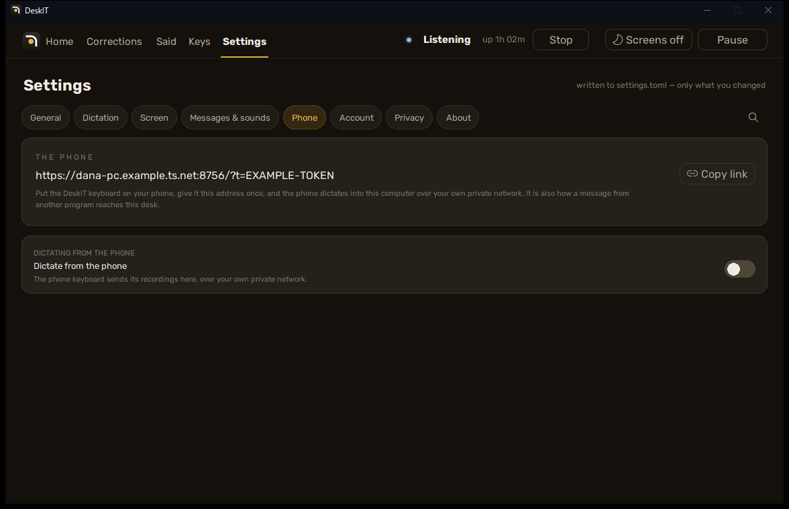

[עברית](../he/06-phone) · English

# 6. The phone keyboard

**The two-sentence version.** The DeskIT keyboard for Android records on the phone and sends
the recording to *your* PC: at home straight over your own network, and away from home through
your own account, locked so that only your own devices can read it. Your PC transcribes it with
the same Hebrew model and the same learned words, and the text lands in the field on the phone.

## What you need

- DeskIT running on the PC with **Dictate from your phone** on (the wizard's last page, or
  **Settings > Phone**).
- **Tailscale** on the PC and on the phone, signed into the same account — this version
  reaches the PC over your Tailscale network only. Pairing over home Wi-Fi without Tailscale
  is planned for a later version.
- The keyboard APK from the [latest release](https://github.com/DeskIT-app/DeskIT/releases/latest)
  (`DeskIT-keyboard-x.y.z.apk`); a Play listing comes later.

## Setting it up

1. Install Tailscale on both devices; confirm the PC has an address with `tailscale ip -4`.
2. Turn **Dictate from your phone** on. **Settings > Phone** shows the address the PC listens
   on and a **Copy link** button.

   
3. Give the address HTTPS, once, in a terminal on the PC:

   ```
   tailscale serve --bg 8756
   ```

   Android refuses the microphone on a page that is not a secure context; this fronts the
   listener with a real certificate at `https://<pc>.<tailnet>.ts.net/`.
4. Install the APK on the phone, open the DeskIT keyboard app, paste the whole link from
   **Settings > Phone** into its first field (it splits the address and the token for you),
   grant the microphone, and enable the keyboard under Android's keyboard settings.
   **Save and test** sends one second of silence to prove the whole path.
5. In any app: switch to the DeskIT keyboard, hold the microphone key, speak, release.

## What leaves the phone, and where

- The recording goes to your PC only. At home it goes straight to it, over TLS. Away from
  home it goes through your account (below), locked with your account's own key: the account's
  server carries sealed bytes it cannot open. Nothing goes to the developer.
- The PC does the transcription; the phone shows the result. What you taught DeskIT at the
  desk (learned words, the repair pass if you turned it on) applies to the phone's text too —
  under the same consent switches as at the desk. If the cloud repair is on at the desk, the
  phone's text goes through it as well.
- The keyboard refuses to work in password fields.
- **Forget** on the phone removes the address and the token; turning the switch off on the PC
  stops it listening.

## Away from home

When the phone cannot reach your PC on the network it is on (you are out, on mobile data, or on
someone else's Wi-Fi), the keyboard reaches it **through your account** instead: the recording
goes up in pieces on your account's own private channel, each piece locked with your account's
key, and the PC's text comes back the same way. It is your PC's model and your learned words,
as at home. Nothing to set up and nothing to press.

- **You always know.** The keyboard's line says *via your account* when the text came this way:
  *3.7 s · local via your account*.
- **Who can read it.** Only devices of your account: the account's server sees that pieces of
  some size passed, never what is in them. A phone you removed with **Forget** is refused by your
  PCs.
- **The PC must be on**, with DeskIT running and **Dictate from the phone** on. **Settings >
  Phone** on the PC has **Also from outside home**, on by default; off, that PC does not answer
  away from home.
- **When no PC answers** this way either, the keyboard goes on to your cloud key, below, or the
  recording waits on the phone for **Send again**.

## When your PC can't be reached

The keyboard has a backup: when no PC of your account answers within about a second, at home or
through your account, it sends
that recording to **Groq** (or **Gemini**, if that is the only key you have) with **your own
key**, and the text lands in the field as usual. It is on unless you turn it off. The phone
shows it once, with the switch already on; you can turn it off there, or later in the phone's
Settings, under **When your PC can't be reached**.

- **The key.** The same key your PC uses: it lives in your account, locked with your account's
  key. Add, change or remove it in the phone's Settings, under **Your cloud keys**, or on the PC
  — a change on one reaches the other by itself. The phone opens it for one request and keeps
  nothing readable.
- **You always know.** The keyboard's line says *Transcribing in the cloud…* while it works and
  *from the cloud (Groq)* when the text is in. **What you said** on the phone marks it too.
- **The price.** The provider hears that recording, and its words are less accurate than your
  PC's, with none of the words DeskIT learned. That is why it is a backup and never the first
  road.
- **Afterwards.** The recording is deleted from the phone. Only the text goes on to your PCs,
  locked, and appears on their **Said** page marked *From the cloud* — only if your account
  keeps what you said.
- **No key yet?** Away from home, a recording that could not be sent waits, and the button
  beside it reads **Add a key** instead of **Send again** until there is a way to send it.

## Trouble

- "Cannot connect": is Tailscale up on both, and is the PC's DeskIT running with the switch
  on? The dashboard's foot says `phone live` when the listener is up.
- Another program holds port 8756: DeskIT falls through to the next free port and
  **Settings > Phone** shows the one in use; paste the link again on the phone.
- Windows Firewall asks once whether DeskIT may accept connections: allow it on **Private**
  networks.
